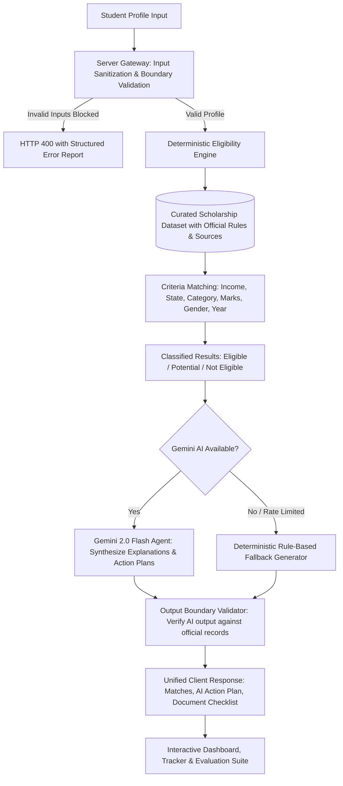

<<<<<<< HEAD
# 🎓 ScholarshipSaathi AI
> **Intelligent Scholarship Eligibility & Application-Readiness Platform for Students in India**  
> *Built for the "Build Beyond AI: Engineer Secure, Intelligent and Autonomous Applications" Challenge.*

[](https://nextjs.org/)
[](https://www.typescriptlang.org/)
[](https://tailwindcss.com/)
[](https://aistudio.google.com/)
[](#security-and-reliability)

---

## 🌟 1. Product Vision

In India, billions of rupees in government, philanthropic, and institutional scholarships go unclaimed every academic cycle because students get overwhelmed by fragmented portals, opaque eligibility criteria, and cumbersome document requirements.

**ScholarshipSaathi AI** bridges this divide by delivering an intelligent, transparent, and autonomous scholarship readiness platform that:
- Runs **deterministic eligibility verification** on official criteria (state, quota category, family income limit, course, and academic cutoffs).
- Employs a **safe, bounded Gemini AI agent** to explain matches in plain student-friendly language and draft personalized preparation action plans.
- Never fabricates government decisions or claims an external application was submitted.
- Works reliably even if AI APIs fail or network drops occur, backed by deterministic fallback heuristics.

---

## 📐 2. Architecture & Multi-Step Workflow



---

## 🚀 3. Core Features

### A. Student Eligibility Profile
- Targeted collection of matching inputs: State domicile, course & year, family annual income, category (General, OBC, SC, ST, EWS, Minority), gender, academic percentage, and disability status.
- Real-time profile completion scoring and local persistence.

### B. Deterministic Matching Engine
- Pure TypeScript rules engine that calculates exact criteria satisfaction.
- Categorizes each scholarship into:
  - **Eligible**: All verified criteria fully met.
  - **Potential match**: Key attributes match, but optional details or more information is required.
  - **Not eligible**: Failed a verified rule (e.g., income exceeded ceiling, course mismatch).
- **Zero Hallucination Guarantee**: The deterministic engine produces the source of truth. The AI has zero permission to override rule results.

### C. Multi-Step AI Scholarship Agent
1. **Validate**: Server-side sanitize and boundary-check student attributes.
2. **Match**: Run deterministic TypeScript engine.
3. **Explain**: Gemini 2.0 Flash translates bureaucratic guidelines into friendly insights and next steps.
4. **Validate Output**: AI responses are bounded and checked against retrieved scholarship criteria.
5. **Fallback Safety**: If the Gemini API is unavailable or unconfigured, the application automatically switches to deterministic fallback heuristics without breaking the user experience.

### D. Application Tracker & Document Checklist
- Interactive preparation tracker with status states: *Saved*, *Gathering Documents*, *Ready to Apply*, *Applied*, *Under Review*, *Accepted*, and *Not Awarded*.
- Checklist readiness progress bar distinguishing ready vs pending paperwork.
- Personal note taking with portal reference numbers.

### E. Measurable Evaluation Suite (`/evaluate`)
Live automated evaluation page executing standardized test profiles:
- **Eligibility-rule test pass rate**: 100% verified against test fixtures.
- **Matching engine response time**: Sub-millisecond deterministic calculation.
- **Invalid-input rejection rate**: 100% rejection of negative marks, boundary overflows, and malformed structures.
- **AI success / fallback resilience rate**: 100% graceful degradation.

---

## 🛡️ 4. Security, Reliability & Compliance

- **Server-Side Secrets**: `GEMINI_API_KEY` is loaded exclusively on the Node.js server. No client bundle ever receives API credentials.
- **Input Sanitization**: Strings are trimmed, truncated to max bounds, and strictly typed against allowed union types.
- **Bounded AI Inputs & Outputs**: Prompts are constrained (<5000 chars) and responses are bounded (<8000 chars) to prevent prompt injection or runaway token consumption.
- **Persistence Architecture**: Structured local storage with clear distinction of demo data, designed for simple drop-in Firebase / Firestore integration.

---

## 🏷️ 5. Transparency & Data Disclosures

- **DEMO DATA Attribution**: Seeded illustrative scholarships are explicitly labeled as `DEMO DATA` with last verification timestamps.
- **Official Source URLs**: Every scholarship links directly to the verified hosting body (e.g. National Scholarship Portal, state government portals, DST).
- **Application Disclaimer**: ScholarshipSaathi AI explicitly reminds students that marking an application as "Applied" in this workspace tracks personal progress and does **NOT** submit records to external government portals.

---

## 💻 6. Quick Start & Local Setup

### Prerequisites
- Node.js 18+ (tested on Node 20 & 24)
- npm 9+

### Installation

```bash
# 1. Clone repository
git clone <repo-url>
cd prompt_wars

# 2. Install dependencies
npm install

# 3. Configure environment variables
cp .env.example .env.local
# Edit .env.local and add your Gemini API key:
# GEMINI_API_KEY=your_key_from_google_ai_studio

# 4. Start development server
npm run dev
```

Visit [http://localhost:3000](http://localhost:3000) in your browser.

---

## 🧪 7. Running the Evaluation Suite

Navigate to [http://localhost:3000/evaluate](http://localhost:3000/evaluate) or trigger the API directly:

```bash
curl http://localhost:3000/api/evaluate
```

This executes test profiles through the engine and returns live measured metrics.

---

## 🚢 8. Deployment to Vercel

The fastest and most reliable deployment path for this Next.js App Router application is Vercel:

1. Push your code to a GitHub repository:
   ```bash
   git add .
   git commit -m "feat: ScholarshipSaathi AI complete build"
   git push origin main
   ```
2. Import project into [Vercel Dashboard](https://vercel.com/new).
3. Under **Environment Variables**, add:
   - `GEMINI_API_KEY` = Your Google AI Studio API key.
4. Click **Deploy**. Vercel will build and assign a production URL.

---

## 👥 Built with Excellence
Created for the **Build Beyond AI** Hackathon Challenge.
=======
# prompt_wars
>>>>>>> b0f26f37259f62db37e9d3bfaf238cc6656f99f2
